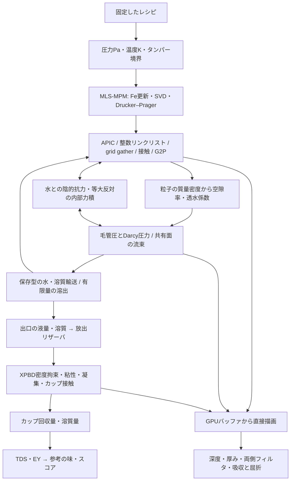

# v4.2 GPU連成ソルバー：実装と検証範囲

実装は `src/gpu/coupled-solver.js` とWGSLカーネル群です。公開画面の「物理計算を選ぶ」から起動します。v4.2.1以降、スマホの自動モードは簡易モデルを使います。GPUは明示的に選択できます。PCの自動モードは対応adapterを取得できればGPU、取得できなければ簡易モデルを使い、利用中の方法を表示します。粉体粒子数はスマホ32,768、PC100,000、自分で100,000／250,000／500,000を選択できます。液体は別に最大2,048粒子です。「50万」は粉体の計算点数で、50万個の液体粒子という意味ではありません。

## 実行されるパイプライン



JSはコマンドの発行と集計を担当します。MPMの位置・変形・塑性、ベッドの水／溶質、自由液体の位置と質量はGPUバッファにあります。CPUで50万粒子の位置を更新する構成ではありません。診断の読み戻しは128粒子ごとのreductionと集計16 vec4です。`readParticles` と `readCells` は検証用です。

## 粉体

- 144 B/粒子：位置と質量、速度と体積、APIC C、弾性変形Fe、塑性Jp／累積塑性／残りの可溶分／異常カウンタ。
- 二次B-splineの27ノード転送。整数 `atomicExchange` で作るリンクリストを、ノード側からgatherします。非標準の浮動小数点atomic加算には依存しません。
- `Ftrial = (I + dt C) Fe`。`FᵀF` のJacobi固有分解からSVDを作り、主対数ひずみをDrucker–Prager面へ戻します。引張側のcutoffと塑性体積を保持します。校正前の定数はρ=1,400 kg/m³、μ=5,000 Pa、λ=10,000 Pa、摩擦角35°。
- 重力、円筒側壁、バスケット底、移動タンパーとの接触。初期条件はバスケット内の疎な円筒状の粉体で、豆そのものの破砕をMPMで解いてはいません。WDTの針接触・粉体の侵食・粒径別破砕・実測による硬化則は今後の拡張です。
- CFLを波速・最大速度・圧力の速度スケールから選びます。負のdetや非有限値はカウンタに記録し、セッションを停止します。

## 多孔質の流れと成分

- 既定のMPM格子32³、輸送格子16³。検証には16³／8³も使います。粉体を増やしても輸送格子は勝手に細分化しません。
- 空隙率は各セルの現在の粉の質量と真密度から求め、0.18〜0.72へ制限します。透水係数は粒径²とKozeny–Carman形の空隙率依存、粘度は温度依存です。
- 未飽和セルの毛管圧は `-1200 (1-S)² Pa`。飽和セルは可変係数Darcy圧力のJacobi反復32回、相対移動度は飽和度³に下限を設けます。これは一次の分割解法です。完全な非線形Richards Newton解法や残差収束保証は未実装です。
- 各面の流束を一度計算し、x偶数／奇数、y偶数／奇数、z偶数／奇数の6パスで隣接する2セルへ逆符号で適用します。同じパスでセルを共有しないため、書き込み競合を避けます。移動量を供給水量と受け側の空隙容量で制限し、負の水量を作らずに保存します。格子方向の分割誤差があります。
- 上面は設定圧力、底面は大気圧、側面は無流束。飽和度・圧密の偏りで局所流量が変わります。亀裂や微粉の移動を解くチャネリングモデルではありません。
- 可溶分の初期値は粉の28%。温度依存の一次速度式と飽和濃度220 kg/m³で有限の可溶分を水へ移します。溶けた質量は粒子の粉の質量から差し引きます。溶質は保存型の上流輸送です。溶解による体積変化、分子拡散、豆や焙煎ごとの実測速度定数は含めません。
- 粉と水の相対速度には局所の陰的抗力を適用し、水へ逆向きの力積を返します。水はDarcyの準静的速度へ更新するため、全領域の非圧縮Navier–Stokes運動量解法ではありません。

## 自由液体と描画

出口を通った水＋溶質の質量をリザーバに保存し、1粒子0.25 mgを基本に放出します。粒子枠が埋まっても残りの質量は消えません。停止時は端数も放出します。放出位置は出口ごとの累積流出量のCDFから選び、リザーバ中の溶質は混合したものとして扱います。

空間hashで近傍を探し、2 ms刻みで3回のXPBD密度拘束を解きます。ラグランジュ乗数を累積し、その反復の増分で位置を補正します。予測位置から独立パスで粘性と対称な凝集力を計算し、カップの円錐SDFへ接触させます。底に届いた粒子の水＋溶質を回収集計し、枠を再利用します。これは単相の近似液体モデルで、実測の接触角、空気相、微泡、CO₂核生成を解いていません。固定した1本の液流へ位置を強制する処理はありません。底面の液膜を解いていないため、実機と同じマウステール合流形状の再現性は今後の検証対象です。

`CoupledGpuView` は同じGPUDeviceのstorageから直接粒子を描きます。計算した水飽和度で粉を暗くし、液体粒子には深度／厚み、横縦bilateral、法線復元、濃度と光路長によるBeer–Lambert吸収、スクリーン空間屈折を適用します。機材は既存WebGLのPBRを使い、対応するメッシュ深度をWebGPUでも描いて遮蔽します。WebGLとWebGPUのバッファを共有したと偽装せず、機材のカラー画像だけを合成します。ソフトウェアGPUでは色画像のCPU転送を許容します。粉体・液体位置のCPU転送は行いません。

現段階のGPU合成は、表示変換後の背景色を近似的に線形へ戻して吸収を重ねます。全てが1つの線形HDRパイプラインに統合された構成ではありません。クレマ・湯気は既存の手続き的な光学表現で、液量はGPUの回収量に追従します。追加したGPU粒子は既存WebGL SSR/DoFのG-bufferには入りません。

## 時間、保存則、レポート

準備はMPM時間0.12秒をUIの準備区間7.5秒に対応させます。準備後の粉体は1回の輸送更新に少数の機械ステップを入れる準静的な多重時間刻みです。液体と輸送は同じシミュレーション時間を進めます。これは全相が同じ物理時間刻みの完全な過渡連成ではありません。

バッチが完了して初めて画面の時間を進めます。端末が遅い場合に壁時計へ追いつくため時間を飛ばしません。準備バッチのステップ数は実際の所要時間で調整し、粒子数とCFL刻みを途中で勝手に変えません。一時停止・バックグラウンド・キャンセル・device lostを扱います。GPU初期化には12秒、各バッチには8秒の応答期限を設け、制限時間やエラーでGPUを破棄した場合は、同じレシピの簡易モデルを最初から実行し直すことを表示します。これはGPUの途中結果を完成結果へ置き換える処理ではありません。表示用の初期化を待たずに計算を始め、表示だけが失敗した場合は数値計算を継続します。

常に以下を集計します。

```text
水の保存誤差 = 流入水 - ベッド内水 - (流出液 - 流出溶質)
コーヒー成分の保存誤差 = 初期粉 - 残った粉 - ベッド内溶質 - 流出溶質
流出液の保存誤差 = ベッドからの流出 - カップ回収 - 落下中 - 未放出リザーバ
TDS = カップ内溶質 / カップ内液体質量 × 100
EY  = カップ内溶質 / 初期粉量 × 100
```

目標量で出口を止め、落下中・未放出分を回収して終了します。「ここまでの計算で結果を見る」はポンプを止めた途中結果です。未計算の36 gを作りません。120秒までに目標へ届かなければ未達として終了します。計算のTDS・EYを同じ試行の表・グラフ・レポートへ渡します。味・点数は従来の経験的な参考式で、官能評価の数値解法ではありません。

## 検証と残る商用条件

`tests/coupled-gpu.spec.cjs` は実際のWebGPUカーネルを実行します。adapterがない環境では明示してスキップします。ソフトウェアadapterによる検証方法はREADMEに記載しています。

ソフトウェアGPUで10万／50万粒子の実バッファを確保し、MPM転送・重力・集計を実行しました。初期の1ステップはそれぞれ約0.36秒／1.65秒でした。これはこの環境だけのスモークテストで、50万粒子の全抽出や実機GPUのリアルタイム性能を証明する値ではありません。小規模2,048粒子では圧密から浸透・溶出・カップ回収まで検査しています。

商用判定には、格子／時間刻みの収束、圧力解法の残差、安息角、タンピング荷重曲線、全相の運動量・エネルギー収支、流量／TDS曲線の実測校正、複数端末での長時間・発熱・メモリ検証が残ります。CAD資産・気泡流体・WDT・底面液膜も別の実装項目です。今回公開するのは実際に演算する連成プロトタイプです。
