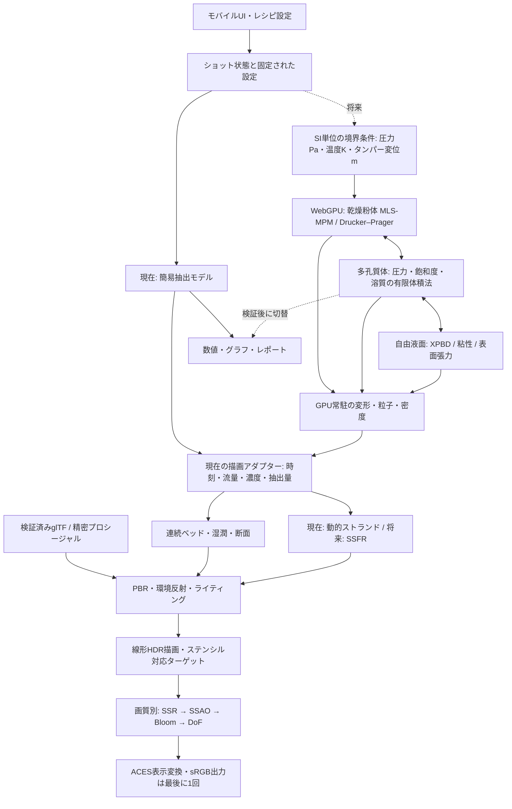

# Espresso Lab：グラフィックスと物理レンダリングの刷新設計

この設計の基準は「見た目」「計算の正しさ」「スマホでの応答性」を別々に検証し、合格したものを統合することです。今回の実装で商用品質や実機との一致を認定したものではありません。高品質なCADアセット、計測に基づく校正、複数の実機GPUでの検証はリリース条件として残します。「世界初」という主張も、先行製品の調査なしには採用しません。

今回の変更は、先に公開した3ステップのモバイルUIを保ち、3D表示とその接続部分を更新します。解析グラフ・レシピ・抽出後のレポートは同じショットデータを使います。以前のダークな3列UIに戻す変更ではありません。

## 実装状況

| 項目           | 今回動く実装                                                                      | 残る検証・開発                                                           |
| -------------- | --------------------------------------------------------------------------------- | ------------------------------------------------------------------------ |
| 断面           | 閉じた旋盤形状のクリッピング、前後面のステンシル巻数、切断面のキャップ            | CADの非多様体・薄肉・複数部品が交差する場合の検査                        |
| 粉体           | 変形する連続ベッド、スマホ9,000／大画面28,000点の表面微粒子、タンピングによる圧密 | 安息角、WDT、塑性、実測密度を再現するソルバー                            |
| 湿潤           | 上から下への色・粗さ変化と局所的な先行経路                                        | 公開画面の湿潤率は流出量からの視覚的な代理値。実測した飽和度ではない     |
| GPU湿潤        | 独立したWebGPU有限体積プロトタイプ、二重バッファ、溶質の上流輸送                  | 毛管拡散だけを扱う。Darcy圧力・MPMとの連成と実機校正は未実装             |
| 液流           | 初期滴下、5本の動的ストランド、流量／圧力に応じた合流と細り、濃度に応じた吸収・色 | ストランドは解析的な描画モデル。合流がCFDから生じる実装ではない          |
| クレマ         | 3D Worleyノイズ、時間変化する流線座標、液面上昇、湯気                             | 微泡の核生成・気液界面・浮力の数値解法は未実装                           |
| SSFR           | 粒子深度→厚み→バイラテラル→法線再構築→Beer–Lambert合成の独立した実装例            | 公開画面には未接続。将来の液体粒子ソルバー向け。屈折はスクリーン空間近似 |
| 造形           | 面取りした旋盤断面、実際の穴を持つ底板、ねじれた刃、頂点を凹ませた豆の溝、木目    | 実在機材のCAD測定値・製造公差・ブランド固有の形状は未導入                |
| 光学           | PMREM環境、異方性・クリアコート・透過、接地影、シネマ設定のSSR/SSAO/Bloom/DoF     | HDRIの撮影校正、粗さ／吸収係数の測定、実機ごとの調整                     |
| MLS-MPM / XPBD | SI単位のインターフェース、実行パス、メモリ／安定性設計                            | 大規模連成ソルバーは未実装。空のAPIを完成した物理として呼び出さない      |

## 1. 全体設計図



### 更新周期と所有権

- UI／カメラ、物理時間、描画時間を分けます。描画が遅れたことを「質量が消えた」ことにしません。物理側は固定時間刻みまたは適応サブステップを使い、描画は状態を補間します。
- 現在の3D描画は標準30fps、省電力24fpsの上限。画面の数値とグラフの更新ループは独立しています。これは実機で30/60fpsを保証する値ではありません。
- 状態の正本はショットまたは検証済みソルバーが所有します。レンダラーからTDS・EY・スコアを逆算しません。
- GPUソルバー導入後の粒子位置・変形勾配・飽和度はGPUに常駐。GPU→CPU読み戻しは低頻度の診断集計に限定し、毎フレーム50万粒子をJavaScriptへ戻しません。
- WebGLのカスタムGLSL／`onBeforeCompile`はWebGPURendererへそのまま移植できません。共有するのは状態と数式で、WebGPU側ではTSLのNodeMaterialまたはWGSLで再実装します。

### 品質の分岐

| モード | 対象                   | 今回の構成                                                                  |
| ------ | ---------------------- | --------------------------------------------------------------------------- |
| 省電力 | 長時間操作・低性能端末 | DPR最大1、24fps上限、PMREM、ポスト効果なし、動的な影なし                    |
| 標準   | スマホの既定           | DPR最大1.25（大画面1.75）、30fps上限、影、断面、微粒子、液流                |
| シネマ | 外観観察・高性能端末   | SSR、SSAO、弱いBloom、浅いDoF。断面中はSSR/SSAO/DoFを止め内部の可読性を維持 |

通常のSSAOPassやBokehPassは材質を一括置換するため、変形ベッド・ステンシル用メッシュ・切断キャップを正しいG-bufferに自動では出しません。今回の断面モードでこれらを無条件に重ねないのはそのためです。商用版では色・法線・深度・object/material IDの全パスで同じ変形／clip／capを適用する専用G-bufferを作り、断面にもAOとDoFを戻します。SSRは画面外の物体を反射できないため、PMREMやローカル反射プローブと併用します。

## 2. カッタウェイ・圧密・湿潤シェーダー

### ステンシルの処理順

`src/render/cutaway.js` が実装です。

1. ソリッドは厚みを持った閉じた形状にします。単なる片面の筒を「切断」しても、切断面は定義できません。
2. 色と深度を書かず、クリップされた背面をIncrementWrap、前面をDecrementWrapで描きます。
3. 本体を同じクリッピングプレーンで描きます。
4. ステンシルが0でない場所だけ切断平面のキャップを描き、深度を書きます。
5. ソリッドごとにステンシルをクリアします。部品Aの巻数で部品Bのキャップを塗らないようにします。

WebGLRendererとEffectComposerのターゲットには `stencil: true` / `stencilBuffer: true` が必要です。切断平面はモデル座標と混同しません。現在はワールドの `z=0` に固定し、バスケット・ヘッド・粉体はY方向だけ移動します。任意回転するCAD部品では平面を各ローカル座標系に変換する処理が必要です。

```js
const plane = new THREE.Plane(new THREE.Vector3(0, 0, -1), 0);
const section = capSolid({
  parent: scene,
  geometry: closedBasketGeometry,
  material: chrome,
  plane,
  capGeometry: sectionPlaneGeometry,
  capMaterial: brushedCutSurface,
  order: 20,
});
section.setEnabled(true);
```

### ベッドの連続表面

`src/render/shaders.js` の `powderMaterial`、`powderDepth`、`microPowderMaterial` を使います。体積を埋める基体を描き、表面微粒子は質感のために重ねます。微粒子でバスケットを埋めようとしません。

現在の表示用高さは、投入率 `f`、圧密度 `c`、中心からの距離 `r` に対して、次の連続式です。

\[
h(r)=f\{h_0+0.14(1-c)(1-r^2/R^2)\}(1-0.24c)
\]

この式は「山ができ、押すと平らになる」視覚モデルです。物理的な質量・体積・空隙率はまだこの形状変形から求めません。商用モデルでは乾燥固体質量を固定し、\(V_{bed}=m_{dry}/[\rho_{solid}(1-\phi)]\) から高さを求め、塑性による空隙率変化を共有します。タンピング圧のNまたはPaへの変換には接触面積を使い、kgfをそのまま応力にしません。

変形は色だけでなく、頂点法線・影用DepthMaterial・ステンシルの前後面にも同じ関数で適用しています。トップが変形しているのに影だけ円柱、という不整合を防ぎます。

### 湿潤と抽出の表示

GLSLでは、上面からの正規化深さと前線位置を比較し、乾燥／湿潤の拡散色・粗さを滑らかに混合します。局所経路では前線を先行させ、表示上のチャネリングを示します。公開画面では前線位置をカップの流出量から近似しており、毛管浸透の解ではありません。飽和度を実測したかのような数値ラベルにはしません。

```glsl
float depth = (localTop - p.y) / max(localTop, 0.001);
float front = uWet * (1.45 + channel(p.xz) * 0.65) - 0.08;
float saturation = smoothstep(depth - 0.06, depth + 0.06, front);
diffuseColor.rgb = mix(dryColor, wetColor, saturation);
roughnessFactor = mix(0.98, 0.56, saturation);
```

将来の入力はGPUの `S(x)` と `C(x)` です。描画だけで経路を捏造する代わりに、局所透水係数・飽和度・溶質濃度の3Dテクスチャまたはストレージバッファをサンプルします。チャネルは「色の明るい線」ではなく、構造変化と高い局所流束に対応させます。

## 3. 滴下・合流・クレマ・SSFR

### 今回の動的液流

`src/render/fluid.js` が公開画面の実装です。最大5本、軸方向28区間×周方向10点のストランドを更新します。初期はボトムレス底面の複数点から滴下し、流量と圧力が増えると中心ストランドへ描画上の流量配分を移します。

半径は `Q = A v` と重力による速度増加の形を使って下に向かって細くします。表示座標は1 unit ≈ 5 cmとして扱い、g/sからの換算は描画係数を含みます。したがって、これを検証済みのNavier–Stokes解と扱いません。ゼロ流量ではストランドも滴も描きません。

液体材質には `MeshPhysicalMaterial` の透過・厚み・吸収を使用します。濃度の高い初期は暗く、後半は薄い色に変わります。濃度に応じて `attenuationDistance` を変えます。色を塗ることと体積吸収は別の操作です。

### SSFR実装例

`src/render/ssfr.js` はGPU粒子の位置を受け取る独立した参照実装です。現在のストランド描画をSSFRと呼んでいません。

```js
const surface = new ScreenSpaceFluid(width, height, {
  radius: 0.018,
  metersPerUnit: 0.05,
});
const fluidTexture = surface.render(
  renderer,
  particlePositions,
  particleCount,
  opaqueColorTexture,
  opaqueDepthTexture,
  camera,
  cupTDS,
);
// fluidTexture は線形色。必要な合成後、OutputPassで表示変換する。
```

パスの順序は次の通りです。

1. 粒子を球のインポスターとして描き、球面の手前の線形視点深度をRGBA16FのR成分に記録。球面の投影深度を `gl_FragDepth` にも書いて手前を選びます。
2. 厚みを別ターゲットへ加算ブレンド。単一球なら \(\ell=2r\sqrt{1-x^2-y^2}\) 。重複する粒子の厚みをそのまま加える方法は過剰吸収の原因になるため、本番では局所体積率による補正が必要です。
3. 深度を横→縦のバイラテラルで平滑化。深度差が大きい別の面を混ぜず、背景の0深度を除外します。
4. 逆射影と隣接ピクセルの位置差から法線を再構築します。輪郭での不安定さは、本番では左右／上下のうち深度差が小さい方の差分を選び改善します。
5. 不透明シーンの深度と比較し、金属やカップの裏側の液体を隠します。スクリーン空間オフセットで屈折を近似します。
6. Fresnel反射と透過光を合成します。実装例は一定色の環境反射を使い、本番ではPMREM／反射プローブへ置き換えます。

Beer–Lambertは線形RGBで

\[
T(\lambda)=\exp[-\sigma_a(\lambda,C)\ell],\quad
L_o=F L_{reflection}+(1-F)T L_{refracted}
\]

です。`sigma_a` はm⁻¹、`ell` はm。TDSの質量分率を「%表記の10」のまま別の式へ混ぜないよう境界で換算します。実装例のRGB吸収係数 `(200,650,1200) m⁻¹ @ TDS10%` は演出用の仮値です。分光測定なしに、実物のエスプレッソの吸収係数とは主張しません。

### クレマの段階

現在はカップの実際の推定抽出量に応じて液面を上げ、Worleyノイズを流線座標で移流する材質を描きます。湯気はソフトな半透明スプライトです。画面に青い球体を表示しません。

本番の微泡モデルは次の順序にします。

- 豆の鮮度・焙煎度から残存CO₂を校正し、圧力低下による核生成率を推定。
- 低解像度の泡密度／泡径分布を液面グリッドで移流し、合体・排液・破裂を反応項として更新。
- 小泡は法線・粗さ・薄膜散乱へ、大きな泡だけ幾何へ昇格。
- タイガーストライプは外部から流入する油分・微粉・泡密度の差として移流。単なる時間ノイズとの違いを校正。

93℃だから必ず濃い湯気が見えるわけではありません。室温・湿度・照明依存をパラメータ化し、過剰な白煙で液流を隠さないようにします。

## 4. 精密造形・PBR・ポスト処理の統合

### プロシージャル造形

`src/render/geometry.js` に実装しています。

- `turned(profile)`：内外面を含む旋盤断面を回転。バスケットの巻き縁、段付きのヘッド、陶器の肉厚、金属フェルールを作ります。
- `roundedProfile`：円弧で面取りの断面を作成。円柱に金属色を付けただけの輪郭を避けます。
- `perforatedPlate`：Shapeの穴をExtrudeし、底面と孔壁を持つ実形状にします。ベッドはこの底板の上に置き、宙に浮かせません。
- `spiralBurr`：半径に応じたねじれと、両側の斜面・細い刃先を持つ歯を生成します。黄色い円錐の回転ではありません。ただしメーカーのCADから作った刃ではありません。
- `beanGeometry`：球面パラメータから豆形状を生成し、蛇行するセンターカットに沿って頂点を凹ませ、法線を再計算します。
- 木目は決定的に生成する小さなテクスチャ。高品質版では測定済みのベースカラー／粗さ／法線へ移行します。

```js
const chrome = new THREE.MeshPhysicalMaterial({
  metalness: 1,
  roughness: 0.17,
  anisotropy: 0.65,
});
const ceramic = new THREE.MeshPhysicalMaterial({
  roughness: 0.23,
  clearcoat: 0.8,
  clearcoatRoughness: 0.12,
});
const hopperGlass = new THREE.MeshPhysicalMaterial({
  transmission: 1,
  thickness: 0.025,
  ior: 1.48,
  roughness: 0.08,
});
```

物理材質の値を上げるだけではリアルになりません。反射する環境、形状の面取り幅、接合、粗さ、正しいスケールが先に必要です。シャープな金属のエッジをBloomでごまかしません。

### CAD / glTFへの置き換え方

アセンブリは `machine / grinder / burr / basket / shower / tamper / cup` の独立ノードとし、原点、回転軸、接触面、材料スロットを定義します。CADのmmをmへ正規化してから表示スケールへ変換し、単位変換は1か所にまとめます。glTFの転送時はMeshopt、テクスチャはKTX2/Basisを候補にし、初回はLOD1、接写時にLOD0を読み込みます。

`KHR_materials_anisotropy`、`KHR_materials_clearcoat`、`KHR_materials_transmission`、`KHR_materials_volume`、必要に応じて `KHR_materials_ior` を使います。異方性の向きにはUV/tangentが必要です。クロームはベースカラーの写真に照明を焼き込まず、反射環境から光らせます。メーカーCAD・製品ロゴ・HDRI・テクスチャの利用権と配布権は納品アセットごとに記録します。

### 照明とポスト処理

現在はローカルに同梱したThree.jsとRoomEnvironmentからPMREMを生成します。CDN接続は不要。処理する色は線形、最後にACESとsRGBへ変換します。環境露出と吸収係数を同時に調整して「見た目だけ合う」状態を校正結果にしません。

シネマモードの外観では `RenderPass → SSRPass → SSAOPass → UnrealBloomPass → BokehPass → OutputPass`。Bloomは強い金属ハイライトに限定する高い閾値・弱い強度です。造形のUVを備えて異方性反射の接線系を定義し、Bloom入力では非数・無限大や極端なハイライトが多段ぼかしを汚染しないように制限しています。DoFは注視点距離に追従し、計器や粉体内部の観察を阻害しない浅い設定です。断面中はBloom以外の追加パスを止めます。

SSAOは微粉数十µmの個々の粒の陰影まで解く技術ではありません。そのスケールは材質法線／粗さ／遮蔽率で表現します。SSRは隠れたカップや画面外の機材を復元できません。GTAO・ボリュメトリックな湯気は今後のオプションで、今回のSSAOとスプライトをそれらと呼び替えません。

## 5. WebGPU：MLS-MPM / XPBD連成の実装アーキテクチャ

### 物理を適用する領域

乾燥粉体・タンピングはMLS-MPM、圧密後の水は多孔質体の流れ、フィルターを出た液体はXPBD自由液面へ分けます。ベッド中のµmスケールの全空隙を水粒子で直接解く方法は、スマホや数十万粒子の予算とは整合しません。

基準長さはm、質量はkg、時間はs、圧力はPa、温度はK、濃度はkg-solute/kg-solutionまたはkg/m³のどちらかをフィールドごとに固定します。UIのbar・g・℃・%は境界で変換します。

### 構成則と時間積分

乾燥粉体の変形勾配は

\[
F^{n+1}_{trial}=(I+\Delta t\nabla v)F^n
\]

をSVDで \(U\Sigma V^T\) に分け、主対数ひずみ \(e=\log\Sigma\) をDrucker–Prager降伏面へreturn-mapします。

\[
f=\|dev(e)\|+\alpha\,tr(e)-k\le0
\]

ここで圧縮を負とする符号を統一し、引張側のtension cutoff、摩擦角からの \(\alpha\) 、硬化、圧密による空隙率更新を含めます。`det(F)>0`、最小特異値、エネルギー散逸、塑性体積が許容範囲にあることを各テストで確認します。SVDせずに適当に速度を減衰させたものをDrucker–Pragerと呼びません。

必要なGPUパスは `src/gpu/coupled-solver-contract.ts` の `computeStages` に定義しています。

```text
clear grid
→ particle cell hash / histogram
→ exclusive prefix scan / sorted particle indices
→ update F / SVD / plastic return-map
→ grid-centered gather of mass, momentum and APIC terms
→ grid forces, frictional contact, tamp/WDT boundaries
→ Richards/Darcy pressure solve and conservative face fluxes
→ water/solute update and equal/opposite drag transfer
→ G2P / APIC update
→ free-liquid neighbor grid / XPBD density iterations
→ viscosity and surface tension
→ reductions: mass, solute, energy, residual, NaN
```

WebGPUの標準WGSLで浮動小数点の `atomicAdd` を当然に使えるとは仮定しません。P2Gはソート済み近傍セルを使うgrid-centered gather、またはworkgroup内reduction＋分割gatherを基本にします。整数固定小数点atomicsは量子化誤差とオーバーフローの上界を証明できる場合だけ使用します。全粒子を1つのグリッド要素へ非atomicに加算する実装は不正です。

### 多孔質流と溶質

\[
\mathbf q=-\frac{k(\phi)k_r(S)}{\mu(T)}(\nabla p-\rho\mathbf g)
\]
\[
\partial_t(\phi S)+\nabla\cdot\mathbf q=s_w
\]
\[
\partial_t(\phi S C)+\nabla\cdot(C\mathbf q-D\nabla C)=R_{dissolution}
\]

未飽和域では毛管圧関数 \(p_c(S)\) と相対透水係数を含むRichards型を採用します。流束はセル中心同士で独立計算せず、共有faceで1度だけ求め、両側へ符号を反転して適用します。透水係数は体積率や粒径に依存させ、チャネルは塑性／局所侵食による構造変化として形成させます。

フィルター出口では放出した液体粒子の質量をベッドから引き、ソリッド・水の抗力交換は等大反対向きにします。これがないと、見た目が連成していても質量や運動量が増減します。溶出率・温度依存・拡散係数・透水係数の決定には実測が必要です。

独立した `src/gpu/wetting-reference.js` / `wetting.wgsl` は、毛管拡散の有限体積計算と上流濃度輸送の最小例です。境界で受け入れた水・溶質と排出量を別バッファに記録します。陽解法の条件 `dt ≤ dx²/(6D)` を検査します。圧力解法、重力移流、溶出、粒子連成は含みません。公開画面への接続前に、貯留・流入・流出の保存テストを拡張します。

### XPBD自由液面

密度拘束 \(C_i=\rho_i/\rho_0-1\) にcomplianceを使い、局所圧力の解像度依存を管理します。時間刻みを変えたときcomplianceをそのまま任意のばね定数として扱いません。空間hashによる近傍探索、XSPHまたはimplicit粘性、表面張力、接触角、固体のSDF境界を別パスにします。高粘性、圧縮性、気泡、乱流を全部1種類の粒子に押し込まず、必要な範囲から検証します。

### 粒子数・メモリ・安定性

| 構成                                                            | 100,000粒子 | 500,000粒子 |
| --------------------------------------------------------------- | ----------: | ----------: |
| pos/mass 16B + velocity 16B + APIC C 48B + F 48B + material 16B |     14.4 MB |       72 MB |
| 同状態のping-pong                                               |     28.8 MB |      144 MB |
| 128³ gridのmass/momentum 16B                                    |   約33.6 MB |   約33.6 MB |

さらにソート・隣接・圧力・速度・飽和度・SSFRターゲットが必要です。1バッファのbinding上限、総メモリ、workgroup上限をadapter.limitsで確認します。WebGPU対応だけを理由に50万粒子を起動しません。

明示MPMの安定条件は概ね

\[
\Delta t\le c_{CFL}\frac{\Delta x}{\sqrt{(\lambda+2\mu)/\rho}+v_{max}}
\]

です。例えば粒子を細かくして材料を硬くすると、1描画フレームに数百〜数千サブステップ必要になることがあります。「50万粒子がWebGPUならスマホ60fps」とは保証できません。圧密工程は準静的・implicit MPMも比較し、水と粒子はmulti-rateで連成、必要なら物理時間を遅く進めてその倍率を表示します。予算超過時にサブステップだけ減らして不安定にすることは避けます。

GPU timestampが使える端末ではステージ別時間を測ります。使えない端末はフレーム時間の移動中央値を使い、まず描画解像度とSSR/DoFを下げます。物理粒子数を途中で変える場合は、質量・運動量・塑性状態を保存する粒子分割／統合が必要です。現在の実装は手動画質設定までで、自動品質制御は今後の開発です。

## 6. 導入順とリリース判定

| 段階     | 成果物                                                                   | 次へ進む条件                                                     |
| -------- | ------------------------------------------------------------------------ | ---------------------------------------------------------------- |
| 今回     | モバイルUIを保つWebGL PBR、断面、ベッド、液流、造形、独立SSFR／GPU湿潤例 | 実ブラウザのシェーダー検査、既存の抽出体験、状態の一致、代替表示 |
| 次段階   | 材質とCAD、専用G-buffer、実機撮影とのルック調整                          | 寸法・権利確認、切断面／法線／深度の一致、代表端末の計測         |
| 物理MVP  | 小規模な乾燥粉体MPMと校正済み多孔質流、MPMと水の境界                     | 安息角・タンプ密度・圧損・流量と抽出曲線の再現性、質量収支       |
| 液体連成 | XPBD出口・SSFR・クレマ                                                   | 水／溶質／運動量収支、時間刻み・解像度に対する収束               |
| 商用判定 | アセットLOD、50k→100k→500k検証、品質自動制御、セッション復旧             | 狙う端末でのp50/p95時間・熱・メモリ・連続運転、校正誤差の公開    |

検証対象はDarcy流の解析解、単純せん断、静置山の安息角、タンピングの荷重−変位曲線、排液の重量履歴、溶出質量の収支を含めます。許容誤差は測定器の誤差と用途から決め、画像がきれいであることを物理の検証に代用しません。校正していない予測は、現在と同様に参考値と明示します。

## 主要な実装ファイル

- `src/render/espresso-scene.js`：画質、カメラ、部品、照明、ポスト処理の統合
- `src/render/cutaway.js`：クリッピングとステンシルキャップ
- `src/render/shaders.js`：ベッド変形、湿潤、微粒子、クレマ、湯気
- `src/render/fluid.js`：滴下と動的ストランド、液面
- `src/render/geometry.js`：精密プロシージャル形状
- `src/render/ssfr.js`：独立SSFR実装
- `src/gpu/wetting-reference.js` / `wetting.wgsl`：独立WebGPU計算例
- `src/gpu/coupled-solver-contract.ts`：大規模連成の契約とパス構成（未実装を明示）

## 参考となる一次資料

- [Three.js MeshPhysicalMaterial](https://threejs.org/docs/#api/en/materials/MeshPhysicalMaterial)
- [Three.js clipping stencil example](https://threejs.org/examples/webgl_clipping_stencil.html)
- [Three.js WebGPU / TSL](https://github.com/mrdoob/three.js/wiki/Three.js-Shading-Language)
- [WebGPU specification](https://www.w3.org/TR/webgpu/) / [WGSL specification](https://www.w3.org/TR/WGSL/)
- Hu et al., 2018, _A Moving Least Squares Material Point Method with Displacement Discontinuity and Two-Way Rigid Body Coupling_, ACM TOG.
- Klár et al., 2016, _Drucker-Prager Elastoplasticity for Sand Animation_, ACM TOG.
- Macklin et al., 2016, _XPBD: Position-Based Simulation of Compliant Constrained Dynamics_, MIG.
- van der Laan et al., 2009, _Screen Space Fluid Rendering with Curvature Flow_, I3D.

## 今回の検証環境

ChromiumのWebGLでシェーダーをコンパイルし、粉砕・圧密・湿潤・液流・シネマの画面を検査しています。SSFRは粒子深度への実際の書き込みと描画状態の復元も確認。WebGPU参照計算はSwiftShaderのadapterで実行し、流入量と水の積算、溶質濃度の保存を確認しました。これはスマホ実機のフレームレート、熱、精度の検証を代替するものではありません。
