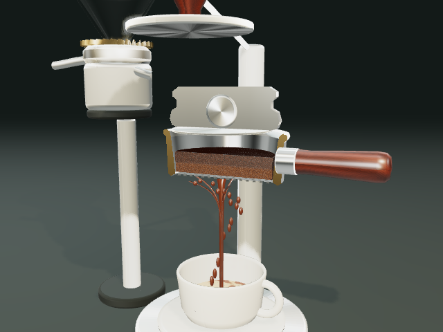
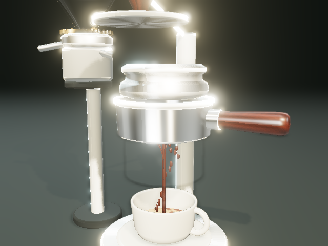

# モバイル画面プレビュー

390 × 844 px、Chromiumでの表示です。実際の画面は縦にスクロールできます。

| レシピを決める                            | 一杯を振り返る                               |
| ----------------------------------------- | -------------------------------------------- |
|  |  |

抽出後は下にスクロールすると、最終指標、点数の内訳、レシピ設定、途中経過の表、グラフ、次の調整、期待度の評価が続きます。

## 3D描画の刷新

| 断面・湿潤・抽出液                     | シネマ画質の外観                                     |
| -------------------------------------- | ---------------------------------------------------- |
|  |  |

精密プロシージャル造形と表示用シェーダーによる実装です。校正済みの流体解やメーカーCADに基づく最終アセットではありません。設計・実装状況は[アーキテクチャ文書](../architecture/graphics-physics.md)に記載しています。
